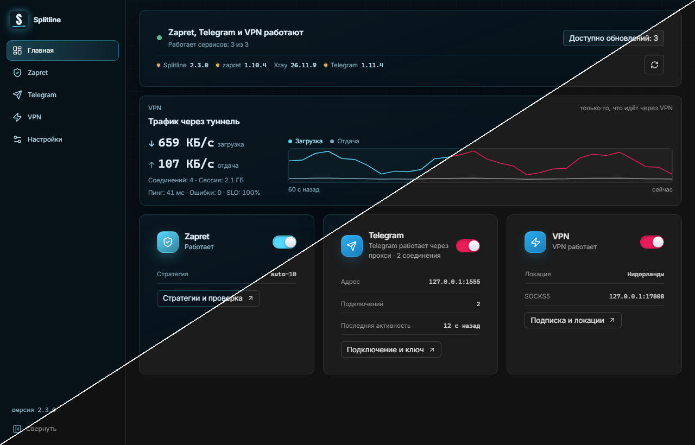
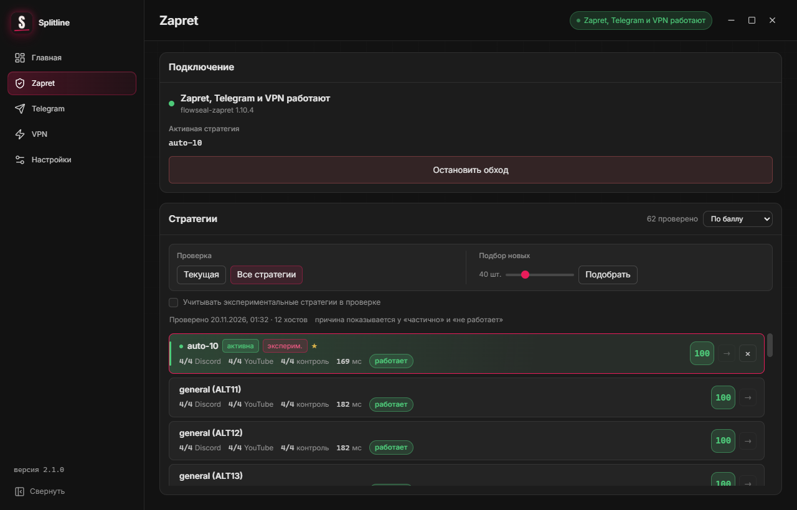
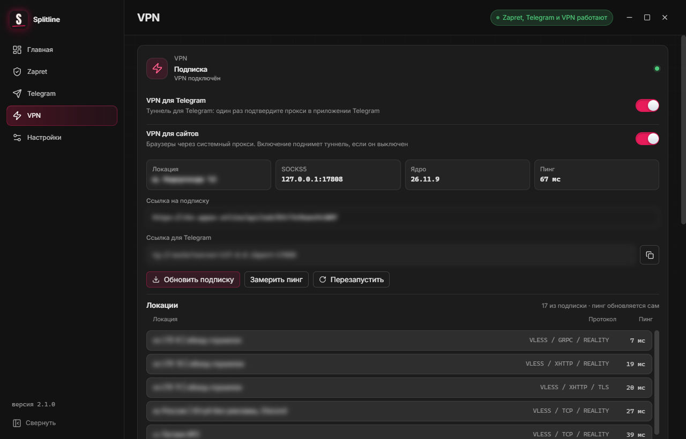
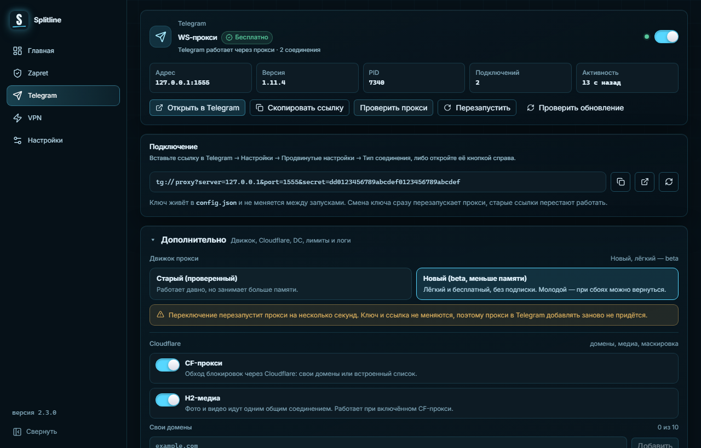

<p align="center">
  
</p>

<h1 align="center">Splitline</h1>

<p align="center">
  Обход блокировок для Windows: Discord и YouTube без DPI, VPN по подписке<br />
  только для выбранных сайтов и бесплатный Telegram через локальный прокси.
</p>

<p align="center">
  <a href="https://github.com/Dezuron/splitline/releases"><strong>Скачать для Windows 10/11</strong></a><br />
  <sub>портативный архив · 5,7 МиБ · x64 · без установки</sub>
</p>

<p align="center">
  <a href="https://github.com/Dezuron/splitline/releases"></a>
  
  
  
  
  
  
</p>

<p align="center">
  
</p>

<p align="center">
  <sub>На скриншотах обе темы сразу: сверху слева — «Спутник», снизу справа — «Кармин».</sub>
</p>

**Что нового в 2.3.1.** Страница Zapret — в одном стиле с Telegram и VPN: свой статус обхода,
переключатель в шапке и метка «Бесплатно». Окно при запуске выше, поэтому «Главная» вместе
с карточкой «Версии» видна целиком.

Splitline закрывает три разные задачи одним приложением:

| Задача | Что делает Splitline |
| --- | --- |
| DPI-блокировки (Discord, YouTube) | управляет бесплатным **flowseal-zapret**: стратегии, служба, замер, подбор |
| Сайты, заблокированные по IP | поднимает **Xray** по вашей подписке и пускает через туннель **только выбранные сайты** |
| Telegram | бесплатный WS-прокси или SOCKS5 через VPN |

На «Главной» внизу — отдельная карточка «Версии»: Splitline, zapret, Xray и Telegram-прокси,
точки у доступных обновлений и кнопка ручной проверки.

Портативный exe **15,2 МиБ**. В памяти нативный процесс занимает **~46 МБ**; процессы WebView2,
которые рисуют окно, считаются отдельно и могут занимать сотни мегабайт.

## Содержание

- [Установка](#установка)
- [С чего начать](#с-чего-начать)
- [Что умеет](#что-умеет)
- [Ограничения](#ограничения)
- [Вопросы и ответы](#вопросы-и-ответы)
- [Технические детали](#технические-детали)
- [Данные на диске](#данные-на-диске)
- [Приватность и сеть](#приватность-и-сеть)
- [Сборка из исходников](#сборка-из-исходников)
- [Правовые оговорки](#правовые-оговорки)
- [Благодарности](#благодарности)
- [Лицензия](#лицензия)

## Установка

В релизе один файл — `Splitline_<версия>_x64_portable.zip`. **Установщика нет**: приложение
портативное, не копирует себя в `Program Files` и не требует установки. Настройки, обход и VPN
живут в `%LOCALAPPDATA%\zapret-ui` и переживают замену exe.

| | Портативный архив |
| --- | --- |
| Что скачать | `Splitline_<версия>_x64_portable.zip` со [страницы релизов](https://github.com/Dezuron/splitline/releases) |
| Что внутри | `Splitline.exe`, `README.md`, `LICENSE`, `THIRD_PARTY_NOTICES.md` |
| Размер | exe 14,3 МиБ, архив — около 5,5 МиБ |
| Куда распаковать | в любую папку: `C:\Tools\Splitline`, рабочий стол, флешку |
| Обновление | приложение само скачивает новый exe с GitHub и проверяет SHA-256 |
| Удаление | выключить обход, закрыть приложение, удалить папку и `%LOCALAPPDATA%\zapret-ui` |

### SmartScreen и подпись

Релизы **не подписаны** сертификатом разработчика. Поэтому при первом запуске Windows покажет
синее окно «Windows защитила ваш компьютер»: нажмите **«Подробнее»**, затем
**«Выполнить в любом случае»**. Если Windows блокирует уже распакованный exe, откройте свойства
файла и поставьте галочку **«Разблокировать»** — так снимается метка «файл из интернета».

Гарантий подписи нет, поэтому проверяйте источник: архив должен быть скачан со страницы
[Releases](https://github.com/Dezuron/splitline/releases) этого репозитория. Обновления внутри
приложения сверяются по SHA-256 из GitHub — это защищает от битой загрузки, но не от подмены
самого сайта.

### Требования

- Windows 11 x64 или Windows 10 22H2 x64 (сборка 19045.6456 и новее).
- WebView2 Runtime — в Windows 11 уже есть, на Windows 10 приложение проверит и скажет, если его
  нужно поставить.
- Права администратора: release-сборка при запуске сама показывает запрос UAC. Без них не
  поднимется WinDivert и служба обхода. Debug-сборка (`npm run tauri dev`) запускается без
  повышения.
- Linux и macOS не поддерживаются.

### Что приложение меняет в системе

- Службу Windows `zapret` (автозапуск) — создаётся при включении обхода и удаляется при
  выключении.
- Системный прокси Windows — включается вместе с «VPN для сайтов» и возвращается при выходе.
- Задачу Планировщика `Splitline` — запускает приложение при входе в Windows без запроса UAC.
  Включается и выключается тумблером «Запуск при старте Windows» в «Настройках». Если Windows не
  даёт создать задачу, приложение откатывается на запись в
  `HKCU\Software\Microsoft\Windows\CurrentVersion\Run` и предупреждает, что при входе появится
  запрос подтверждения.
- Файлы в `%LOCALAPPDATA%\zapret-ui` — см. [Данные на диске](#данные-на-диске).

## С чего начать

1. **Запустите `Splitline.exe`** и разрешите запрос UAC.
2. **Скачайте обход.** Мастер настройки предложит загрузить flowseal-zapret (~10 МБ) с GitHub —
   нажмите «Скачать и установить». Можно выбрать другую папку, например рядом с exe.
3. **Включите обход** на «Главной». Если Discord или YouTube не открываются, зайдите в
   «Стратегии и проверка», нажмите «Все стратегии» и выберите ту, что набрала больше баллов.

VPN и Telegram настраиваются отдельно и не нужны для обхода DPI.

## Что умеет

### Обход DPI — Discord и YouTube

<p align="center">
  
</p>

- **Обход как служба Windows** — без консольных окон, поднимается вместе с системой.
- **Все стратегии** из `*.bat`; новые появляются после обновления zapret.
- **Проверка** меряет Discord, YouTube и контрольные хосты, ставит балл и объясняет причину,
  если что-то не работает, — «подмена сертификата», «сброс на рукопожатии», «таймаут».
- **Подбор новых** пробует варианты и помечает лучший. Автоприменение («Применять лучшую после
  проверки») по умолчанию выключено — включает пользователь.
- **Обновление flowseal-zapret** из GitHub. Ваши списки `*-user.txt` и собственные `.bat`
  сохраняются, правки в официальных файлах — нет: их заменяет новая версия.
- Если после применения обход перестал работать, приложение через минуту вернёт прежнюю
  стратегию.

### VPN по подписке

<p align="center">
  
</p>

- **Вставьте ссылку от провайдера** — появятся локации с пингом, выбор и подключение.
  Принимается JSON с конфигами Xray и список ссылок `vless`, `vmess`, `trojan`, `ss`.
- **Через туннель идёт только выбранное**: остальные сайты открываются напрямую, как без VPN.
- **Готовые наборы** `geosite:` — Instagram, Discord, TikTok, YouTube, Twitter/X, Facebook,
  ChatGPT, Rutracker, Telegram, WhatsApp, Reddit, Spotify, LinkedIn. Один пункт вместо списка
  CDN-доменов.
- **Пинг всех локаций** обновляется сам (раз в 5 минут при открытом окне); на «Главной» видно пинг,
  число ошибок и SLO выбранной локации за час.
- **Автопереключение по желанию**: если туннель не отвечает 5 минут, приложение выберет живую
  локацию с лучшим пингом. По умолчанию выключено.
- **Переподключение без участия**: если ядро завершится само, приложение поднимет его
  обратно (до пяти попыток подряд). Ручное выключение остаётся выключением.
- **Остаток трафика и срок подписки**, если провайдер их сообщает, и ссылка в личный кабинет.
- **Подписка обновляется сама**: приложение раз в час проверяет, не прошло ли 12 часов с прошлой
  загрузки, и обновляет список. Проверка идёт только при открытом окне. Если после обновления
  что-то пошло не так, есть кнопка «Вернуть предыдущую подписку».

### Telegram

<p align="center">
  
</p>

- **Бесплатный WS-прокси** — локальный MTProto поверх WebSocket, без подписки и аккаунта:
  включение, ссылка `tg://proxy`, ключ, обновление бинарника. Порт по умолчанию
  `127.0.0.1:1555`. Новый лёгкий движок работает со встроенным списком Cloudflare-доменов
  Flowseal, поэтому дополнительно ничего покупать не нужно.
- **Два движка на выбор** — в «Дополнительно»: старый, проверенный (по умолчанию) и новый, лёгкий,
  с пометкой beta. Переключение на секунды перезапускает прокси, но ключ и ссылка остаются
  прежними, поэтому прокси в Telegram добавлять заново не нужно. Если новый движок не запустится,
  приложение предложит вернуться на старый.
- **Домены Cloudflare, Worker и FakeTLS** — свой список доменов (до 10, в порядке приоритета) с
  балансировкой между ними, до 10 запасных Worker-доменов и маскировка FakeTLS. Если своих
  доменов нет, используется встроенный список Flowseal — ссылки на его инструкции есть рядом.
  С включённым FakeTLS ссылка получает вид `ee…`, и старую ссылку в Telegram нужно заменить на
  новую.
- **Настройки Flowseal без правки файлов** — перенаправление `DC → IP`, буфер и пул соединений,
  подробный лог, «Cloudflare без TLS», тестовые DC и PROXY protocol. Всё в «Дополнительно», с
  короткими подсказками; изменение настроек на секунды перезапускает прокси, ссылка при этом не
  меняется.
- **Если TLS до Cloudflare не проходит** — включите «Cloudflare без TLS» в группе Cloudflare или
  нажмите «Попробовать без TLS» в подсказке. Без TLS идёт только переход до Cloudflare; трафик
  Telegram внутри остаётся зашифрованным.
- **Проверка прокси по кнопке** — что именно сломано и что сделать, простым языком.
  Порт занят, процесс не запущен, домены прокси заблокированы — у каждого случая свой совет.
  У нового движка проверка идёт его собственной самопроверкой.
- **VPN для Telegram** — одна ссылка `tg://socks` на `127.0.0.1:17808`, дальше Telegram ходит
  через туннель сам. Если Telegram сидит на VPN, а не на прокси (или наоборот), приложение
  подскажет и предложит переключиться.
- **Звонки не работают** — подробности в [ограничениях](#ограничения).

### Общее

- Помнит последнее состояние: обход, VPN и Telegram-прокси включаются при следующем запуске,
  если работали при выходе.
- **Карточка «Версии» внизу «Главной»** — Splitline, zapret, Xray и Telegram-прокси; точка
  показывает, где есть обновление, а кнопка с иконкой проверяет все три источника вручную.
- Трей, сворачивание по закрытию, клавиатурная навигация, две тёмные темы — «Спутник»
  и «Кармин». В меню трея — состояние и включение обхода, прокси и VPN по отдельности,
  подсказка при наведении говорит, что сейчас работает.
- **Резервная копия настроек.** «Настройки» → «Резервная копия» → «Экспорт настроек» сохраняет
  один архив `splitline-backup-ГГГГММДД-ЧЧММ.zip`: настройки, ваши списки `*-user.txt`,
  экспериментальные стратегии и историю проверок. Ключ прокси и ссылка на подписку попадают
  в архив только с галочкой — без неё архив можно безопасно хранить рядом с резервными копиями
  документов. На новом ПК «Импорт настроек» сначала показывает состав архива, затем заменяет
  настройки и перезапускает включённые сервисы; прежнее состояние остаётся в папке `backups`.
- **Нет телеметрии и аккаунтов** — что именно уходит в сеть, перечислено в разделе
  [«Приватность и сеть»](#приватность-и-сеть).

## Ограничения

- **Звонки Telegram через прокси и VPN не работают.** WS-прокси и SOCKS5 несут только TCP, а
  звонки идут UDP. Для голосовых звонков нужен полноценный туннель с UDP — VPN или TUN. В
  Splitline такого режима пока нет.
- **Режима TUN нет**: через VPN идут браузеры (системный прокси) и Telegram (SOCKS5). Остальные
  приложения ходят напрямую.
- **Голос Discord** идёт UDP-пакетами мимо прокси: для звонков нужен zapret, а не VPN.
  Приложение предупреждает об этом при добавлении набора.
- Системный прокси действует только на приложения, которые уважают настройки Windows.
- Без прав администратора обход DPI не включится.

## Вопросы и ответы

**Windows пишет «Windows защитила ваш компьютер». Это вирус?**
Нет, это SmartScreen. Релизы не подписаны сертификатом разработчика, поэтому Windows
перестраховывается: «Подробнее» → «Выполнить в любом случае». Скачивайте архив только со
страницы [Releases](https://github.com/Dezuron/splitline/releases).

**Включил обход, а Discord или YouTube не работают.**
Откройте «Стратегии и проверка» → «Все стратегии». Приложение покажет, что именно ломается:
подмена сертификата, сброс на рукопожатии или таймаут. Выберите стратегию с баллом 100 и
включите её. Если ни одна не работает — проверьте права администратора, что служба `zapret`
запущена и что другой VPN или антивирус не перехватывает трафик.

**Сайт через VPN открылся не полностью.**
Страница редко живёт на одном домене: картинки и скрипты приходят с CDN. Пошаговый разбор —
в разделе [«Если сайт открылся не полностью»](#если-сайт-открылся-не-полностью).

**Не работает голос в Discord.**
Голос идёт UDP-пакетами, VPN и системный прокси их не несут. Для звонков нужен обход DPI
(zapret): включите его и проверьте стратегию.

**Пишет, что порт 1555 занят.**
Порт Telegram-прокси заняло другое приложение (часто — отдельно запущенный TgWsProxy). Нажмите
«Занять свободный порт» рядом с ошибкой. VPN использует другие порты — `17808` (SOCKS5) и
`17809` (HTTP).

**Telegram не подключается.**
Нажмите «Проверить прокси»: приложение покажет, что сломано. Затем «Открыть в Telegram» —
ссылка `tg://proxy` подставит адрес и ключ сама. В Telegram может быть активен только один
прокси: если включён VPN, переключитесь на прокси по подсказке в приложении.

**Зачем приложению права администратора?**
WinDivert, через который работает обход, — это драйвер, а сам обход живёт службой Windows.
Поэтому release-сборка при запуске показывает UAC, и права нужны всему приложению целиком:
отдельного режима «только VPN, без повышения» нет.

**Как удалить Splitline?**
Выключите обход на «Главной» (служба `zapret` удалится), закройте приложение, удалите папку с
exe и каталог `%LOCALAPPDATA%\zapret-ui`. Автозапуск отключается тумблером в «Настройках» ещё
до удаления.

## Технические детали

### Как работает VPN

```
Chrome ──► системный прокси 127.0.0.1:17809 ──► Xray ──┬──► VPN   (сайты из списка)
                                                       └──► direct (всё остальное)

Telegram ──► SOCKS5 127.0.0.1:17808 ──► Xray ──► VPN (диапазоны Telegram)
```

Правила в генерируемом конфиге, по порядку:

1. обработчик Stats API — **api** (см. ниже), чтобы служебный трафик не ушёл в белый список;
2. локальные сети и `77.88.8.8` — **direct**;
3. диапазоны Telegram — **туннель**;
4. домены и категории из списка — **туннель**;
5. всё остальное — **direct**.

Приложение **переписывает `routing.rules`** подписки под этот список. Именно поэтому здесь
можно пускать через туннель отдельные сайты: большинство клиентов принимают JSON подписки
как есть и такой возможности не дают.

### Подписки

- **JSON Xray** — один объект или массив: VLESS/Reality и другие протоколы, с `outbounds`
  и, желательно, балансировщиком.
- **Список ссылок** — `vless`, `vmess`, `trojan`, `ss` (SIP002), обычным текстом или в base64.
  Каждая ссылка становится отдельным outbound, сверху — выбор по наименьшему пингу.
- **Clash YAML** не поддерживается: приложение скажет об этом прямо, а не покажет ошибку разбора.
- **Идентификатор устройства** — `MachineGuid` этого ПК, поэтому лимит устройств у провайдера
  не расходуется лишний раз.
- **Требование:** должен быть outbound для прямого трафика (`direct` или любой `freedom`).
  Если его нет, приложение скажет об этом, а не отправит весь трафик в туннель.

### Что мы меняем в подписке

- **Порты локальных inbound'ов.** SOCKS5 переезжает на `127.0.0.1:17808`, HTTP — на
  `127.0.0.1:17809`.
- **Stats API.** Добавляются `stats`, счётчики `policy.system.stats*` и inbound `api` на
  `127.0.0.1` с портом начиная с `10085` — обычно `10085`, при занятости `10086` или `10087`.
  Первым правилом в `routing.rules` ставится `api` → `api`, иначе служебные запросы попадут
  в белый список.
- **`routing.rules`** заменяются нашими: см. порядок правил выше.
- **`domainStrategy`** ставится в `AsIs` — домен уже известен из запроса, повторно разрешать его
  незачем.
- **`routing.script`** удаляется: со скриптом наши правила не применяются.

**Что не трогаем:** `outbounds`, `streamSettings`, `dns`, ключи и адреса серверов.

### Белый список и наборы

- **Поле «Добавить»** — домен или ссылка. `www.` отбрасывается: `domain:example.com`
  покрывает и сам домен, и поддомены.
- **Готовый набор** — категория `geosite:`. «Обновить базы» скачивает и объединяет
  [v2fly/domain-list-community](https://github.com/v2fly/domain-list-community) и
  [Loyalsoldier/v2ray-rules-dat](https://github.com/Loyalsoldier/v2ray-rules-dat)
  в один `geosite.dat` (~11,5 МБ).
- **Загрузить из файла / Выгрузить в файл** — обычный `.txt`, по домену в строке.

### Если сайт открылся не полностью

Страница редко живёт на одном домене: картинки и скрипты приходят с CDN. Порядок действий:

1. Проверьте, что включён тумблер **«VPN для сайтов»**.
2. Откройте DevTools (F12) → **Network** → перезагрузите страницу.
3. Отфильтруйте незагруженные запросы (красные) и скопируйте их домен.
4. Добавьте домен в список — поддомены подхватятся автоматически. Приложение само предложит
   домены, которые нужны странице.
5. Если сервис известный, проще добавить **готовый набор** и нажать «Обновить базы».

## Данные на диске

Каталог называется `zapret-ui` с ранних версий: имя оставлено, чтобы обновление не потеряло
настройки, историю проверок и путь к flowseal-zapret.

```
%LOCALAPPDATA%\zapret-ui\
├── config.json                  — настройки приложения, VPN и Telegram
├── runtime\                     — flowseal-zapret: bin\, lists\, *.bat
├── tmp\                         — временные папки на время обновления zapret
├── bench.json                   — история проверок стратегий
├── bench_state.json             — метка незаконченного подбора: по ней обход
│                                  восстанавливается после сбоя
├── generated.json               — экспериментальные стратегии
├── tgws_update_cache.json       — кэш проверки обновлений прокси (12 часов)
├── tgws\                        — tgws-cli.exe и tgws.log
└── xray\                        — xray.exe, geosite.dat, geosite-index.json,
                                   config.json, subscription.json,
                                   subscription.prev.json, xray.log (+ xray.log.1),
                                   system-proxy-backup.json
```

Папку `runtime` можно перенести в другое место — путь задаётся при первом запуске или в
«Настройках». Остальное приложение находит само. `system-proxy-backup.json` хранит настройки
системного прокси до включения VPN, чтобы вернуть их при выходе; `staging\` и `xray.zip` в
каталоге `xray` живут только на время установки ядра.

## Приватность и сеть

**Нет телеметрии, аналитики и аккаунтов.** Конфиг, история проверок, списки и логи остаются
локально. Но приложение не работает в вакууме — вот полный список адресатов:

- **GitHub** — обновления приложения, flowseal-zapret, бинарника Telegram-прокси, ядра Xray и
  списков доменов: `github.com`, `api.github.com` и хранилище файлов релизов. Новый движок
  Telegram-прокси при пустом списке своих доменов сам скачивает с GitHub список доменов
  Cloudflare — один запрос при запуске прокси.
- **Ваша подписка** — скачивание конфигов, остаток трафика и срок действия.
- **Серверы из подписки** — TCP-пинг локаций для списка и автопереключения (раз в 5 минут при
  открытом окне). Пинг идёт напрямую, не через туннель.
- **Хосты проверки обхода** — `discord.com`, `gateway.discord.gg`, `cdn.discordapp.com`,
  `updates.discord.com`, `youtube.com`, `youtu.be`, `i.ytimg.com`, `redirector.googlevideo.com`,
  `google.com`, `gstatic.com`, `cloudflare.com`, `cdnjs.cloudflare.com`. Это обычные HTTPS-запросы
  к главной странице сервиса, по три на хост (http/1.1, TLS 1.2, TLS 1.3) — так проверка видит,
  на каком рукопожатии ломается обход.
- **`youtube.com/generate_204` раз в минуту**, пока включён VPN, — проверка туннеля, SLO и
  автопереключение.
- **Страница добавленного сайта** — один запрос через туннель, когда приложение ищет, какие ещё
  домены нужны странице.

Больше никуда приложение не ходит.

## Сборка из исходников

Нужны **Node.js 20+**, **Rust 1.77+** с toolchain `stable`, **Visual Studio Build Tools** с
компонентом «Разработка классических приложений на C++» и Windows SDK. WebView2 Runtime для
запуска тоже нужен.

```powershell
npm ci                 # зависимости фронтенда
npm run tauri dev      # запуск в режиме разработки (без UAC)
```

Тесты и проверки:

```powershell
npm run lint           # ESLint
npm run format:check   # Prettier
npm run test           # Vitest
npm run build          # vue-tsc + Vite
cd src-tauri
cargo test             # тесты Rust
cargo fmt --all -- --check
cargo clippy --all-targets -- -D warnings
```

Сборка портативного exe:

```powershell
npm run tauri build    # результат: src-tauri\target\release\Splitline.exe
```

Установщик не собирается: `bundle.active` выключен, релиз — это exe в zip. Версия хранится в
`package.json`, `src-tauri/Cargo.toml` и `src-tauri/tauri.conf.json`; расхождение ловит
`npm run check:version`.

## Правовые оговорки

- Подписка — это договор между вами и провайдером; соблюдайте его условия (число устройств,
  допустимое использование).
- Обход DPI и использование VPN регулируются местным законодательством. Ответственность
  за использование — на вас.
- Проект не связан с Flowseal, bol-van, basil00, XTLS и провайдерами подписок.

## Благодарности

- **Flowseal** — [zapret-discord-youtube](https://github.com/Flowseal/zapret-discord-youtube),
  откуда загружается flowseal-zapret, и [tg-ws-proxy](https://github.com/Flowseal/tg-ws-proxy),
  на котором основан Telegram-прокси.
- **bol-van** — [zapret](https://github.com/bol-van/zapret).
- **basil00** — [WinDivert](https://github.com/basil00/WinDivert).
- **XTLS** — [Xray-core](https://github.com/XTLS/Xray-core), ядро VPN.
- **v2fly** и **Loyalsoldier** — списки доменов для `geosite:`.

`Splitline` — неофициальный GUI и не связан ни с одним из перечисленных проектов.

## Лицензия

MIT — см. [LICENSE](LICENSE). Сторонние компоненты распространяются под своими лицензиями;
flowseal-zapret, Xray-core и бинарник Telegram-прокси скачиваются отдельно и в репозиторий не
входят. Подробности — в [THIRD_PARTY_NOTICES.md](THIRD_PARTY_NOTICES.md).

---

[CHANGELOG.md](CHANGELOG.md) — что изменилось в каждом релизе. [Releases](https://github.com/Dezuron/splitline/releases) — скачать и посмотреть заметки к выпуску.
